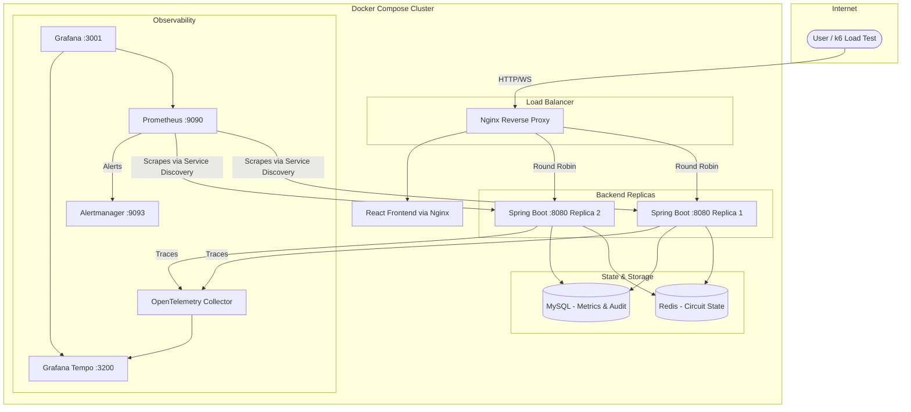
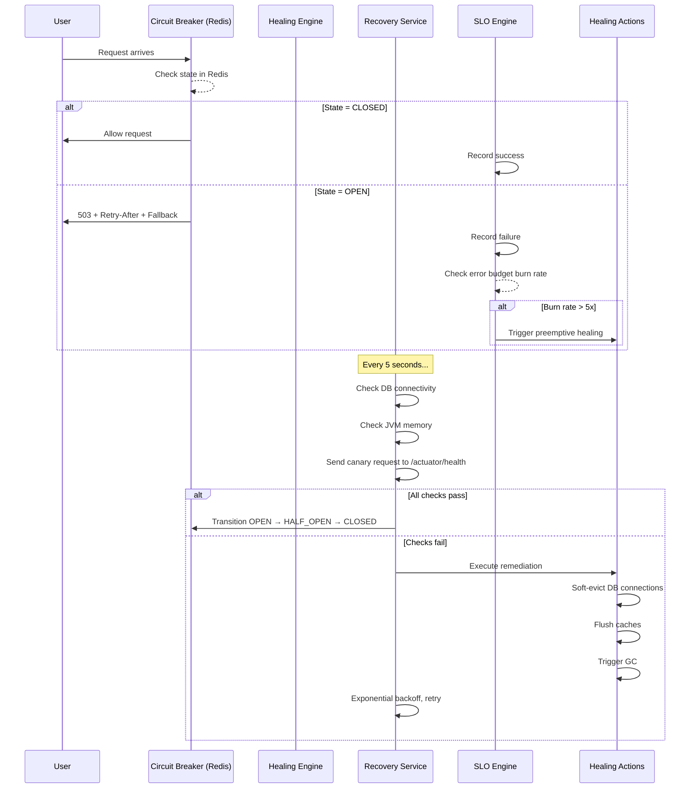

# SHBS — Self-Healing Backend System

A production-grade, SRE-inspired backend system that autonomously detects, mitigates, and recovers from failures in real-time — without human intervention.

Built with **Spring Boot**, **Redis**, **MySQL**, **React**, **Prometheus**, **Grafana**, and **OpenTelemetry**.

---

## Architecture



---

## Self-Healing Pipeline



---

## SLI / SLO Definitions & Operational Targets

| Metric (SLI)                     | Target (SLO) | Measurement Window | Alert Trigger          |
| -------------------------------- | ------------ | ------------------ | ---------------------- |
| HTTP Success Rate (non-5xx)      | 99.9%        | 5-minute rolling   | Burn rate ≥ 14.4x      |
| HTTP Success Rate (non-5xx)      | 99.9%        | 1-hour rolling     | Burn rate ≥ 6x         |
| Health Check Success Rate        | 100%         | Per recovery cycle | Any failure             |
| Circuit Breaker Recovery Time    | < 60 seconds | Per incident       | 3 consecutive failures |

**Error Budget**: With a 99.9% SLO, the system is allowed 0.1% of requests to fail. The `SLOService` tracks a rolling burn rate across two windows (fast: 5-min, slow: 1-hr). If errors are arriving 14.4x faster than the budget allows in 5 minutes, it preemptively triggers self-healing *before* the circuit breaker opens.

### RTO & RPO Targets
- **Recovery Time Objective (RTO)**: `< 30 seconds`. The system should autonomously detect a failure, trigger a circuit breaker, apply remediation, and test recovery (HALF_OPEN) within 30 seconds.
- **Recovery Point Objective (RPO)**: `0` (Zero data loss). Achieved through transactional order placement and `Idempotency-Key` tracking to safely retry interrupted flows without duplicate side-effects.

### Circuit Breaker & Retry Policy
- **Threshold**: 5 failures within a 60-second rolling window.
- **State Transitions**: Atomically managed in Redis using Lua scripts for CAS consistency.
- **Probes**: In `HALF_OPEN` state, a maximum of 3 concurrent probes are allowed. 3 successful probes transition the circuit to `CLOSED`.
- **Retry Policy / Backoff**: Downstream calls (e.g., Inventory Service) are retried manually by the Recovery Service. The recovery loop uses an exponential backoff starting at 2s, capped at 30s, with a ±25% random jitter to prevent thundering herds.

---

## Key Design Decisions & Tradeoffs

### Why Redis over In-Memory State?
**Problem**: A simple `private CircuitBreakerState state = CLOSED;` field dies when the JVM restarts and cannot be shared across multiple backend replicas.

**Decision**: We use Redis as the single source of truth for circuit breaker state. All replicas read/write to the same Redis key (`circuit_breaker:state`), ensuring consistent behavior across a distributed deployment.

**Tradeoff**: This introduces Redis as a dependency. If Redis goes down, the circuit breaker defaults to `CLOSED` (fail-open), allowing all traffic through. This is intentional — we prefer to serve potentially degraded responses rather than block all traffic due to a state-store failure.

**Mitigation**: In a production environment, Redis Sentinel or Redis Cluster would provide automatic failover. Our architecture is Sentinel-ready — `spring.data.redis.sentinel.*` properties can be added without code changes.

### Why Exponential Backoff over Fixed-Interval Retry?
**Problem**: If a downstream service is overwhelmed, fixed-interval retries (e.g., every 2 seconds) create a "thundering herd" that hammers the already-struggling service.

**Decision**: `RecoveryService` uses exponential backoff (`2s → 4s → 8s → 16s → 30s cap`), giving the downstream service progressively more breathing room.

**Tradeoff**: Recovery takes longer in the worst case (up to 30 seconds between attempts). We accept this because the fallback/degraded response pipeline ensures users still receive meaningful data during recovery.

### Why SLO/Error-Budget over Simple Threshold Counting?
**Problem**: A fixed failure count threshold (e.g., "open circuit after 5 failures") doesn't account for traffic volume. 5 failures in 10 requests is catastrophic; 5 failures in 10,000 requests is noise.

**Decision**: The `SLOService` tracks a **rolling success rate** against a 99.9% target. It calculates a **burn rate** — how fast errors are consuming the error budget. A burn rate of 5x triggers preemptive healing *before* the circuit breaker opens.

**Tradeoff**: More complex logic, but it aligns the system with SRE best practices and makes the self-healing proportional to actual impact rather than arbitrary thresholds.

### What Happens If Redis Goes Down?
1. `CircuitBreakerService.getState()` catches the exception, returns `CLOSED` (fail-open).
2. All traffic is allowed through — the system degrades to "no circuit breaker protection" rather than blocking everything.
3. The health check in `RecoveryService` will detect the Redis failure (if wired) and trigger remediation.
4. **Production fix**: Add Redis Sentinel with `spring.data.redis.sentinel.master` and `spring.data.redis.sentinel.nodes` for automatic failover.

---

## AI-Powered RAG Postmortems & Runbooks

SHBS features a Retrieval-Augmented Generation (RAG) system built with **LangChain4j** and **Groq**.
It automatically ingests runbook Markdown files on startup and uses them to diagnose incidents.

- **Runbook Ingestion**: `RunbookIngestionService` loads and chunks `/docs/runbooks/*.md`.
- **Vector Search**: `RunbookVectorStore` performs semantic search to find mitigation steps relevant to the current failure.
- **AI Postmortem Generation**: When an incident is auto-resolved, `PostmortemAiService` generates an exhaustive analysis, referencing the runbooks and proposing actionable remediation steps.

Configure via `.env`:
```
GROQ_API_KEY=gsk_your_key_here
```

---

## Roadmap & Implementation Status

### Phase 1: Production Readiness (Completed)
- [x] Flyway migrations and schema ownership.
- [x] Atomic Redis circuit breaker with Lua CAS.
- [x] Non-blocking distributed recovery service with jittered backoff.
- [x] Idempotency-Key enforcement for safe retries.
- [x] Resilience4j bulkheads and rate-limiting limits.

### Phase 2: Observability & Self-Healing (Completed)
- [x] Prometheus metrics for circuit transitions.
- [x] Multi-window (fast/slow) SLO burn-rate alerting.
- [x] Exception-type based failure classification.
- [x] Incident lifecycle auto-management (OPEN = incident created, CLOSED = resolved).
- [x] Liveness/Readiness separation and graceful shutdown.

### Phase 3: Security & Quality (Completed)
- [x] Redis authentication and memory eviction limits.
- [x] Validation DTOs (OrderRequest) applied to endpoints.
- [x] Replaced KEYS with SCAN for Redis performance.
- [x] Auth-restricted simulation and chaos endpoints.

### Phase 4: Production Readiness & Infrastructure (Completed)
- [x] Hardened Docker Compose (isolated networks, resource limits, no public DB ports).
- [x] GitHub Actions CI/CD (linting, testing, security scanning, immutable image tags).
- [x] Nginx TLS termination, rate limiting, and standard proxy headers.
- [x] Terraform AWS Infrastructure (ECS Fargate, RDS, ElastiCache, ALB, Secrets Manager).
- [x] Complete runbooks for deployment, rollback, DR, and incident response.

---

## Running Locally

```bash
# Start the entire stack (2 backend replicas + LB + DB + Redis + Prometheus + Grafana)
docker-compose up --build

# Access points:
# Frontend:   http://localhost:3000
# Backend:    http://localhost:80 (via Nginx LB)
# Grafana:    http://localhost:3001 (admin/admin)
# Prometheus: http://localhost:9090
```

## Running Load Tests

```bash
# Install k6
brew install k6

# Baseline load test
k6 run k6/load-test.js

# Chaos test (inject failures under load, observe self-healing)
k6 run k6/chaos-test.js
```

## Running Unit Tests

```bash
cd backend
./mvnw test
```

---

## Tech Stack

| Layer           | Technology                                    |
| --------------- | --------------------------------------------- |
| Backend         | Spring Boot 3.3, Java 17                      |
| Frontend        | React 18, WebSocket (STOMP)                   |
| Database        | MySQL 8.0 (Flyway migrations)                 |
| Cache/State     | Redis (Circuit Breaker state, backpressure)    |
| Resilience      | Resilience4j (Rate Limiter), Custom Circuit Breaker |
| Auth            | JWT (stateless, Bearer tokens)                |
| Observability   | OpenTelemetry + Prometheus + Grafana + Tempo   |
| Load Testing    | k6 (load + chaos scripts)                     |
| Containerization| Docker + Docker Compose + Nginx LB            |
| CI/CD           | GitHub Actions (Immutable Digest Deployments) |
| Infrastructure  | Terraform (AWS ECS Fargate, RDS, ElastiCache) |
