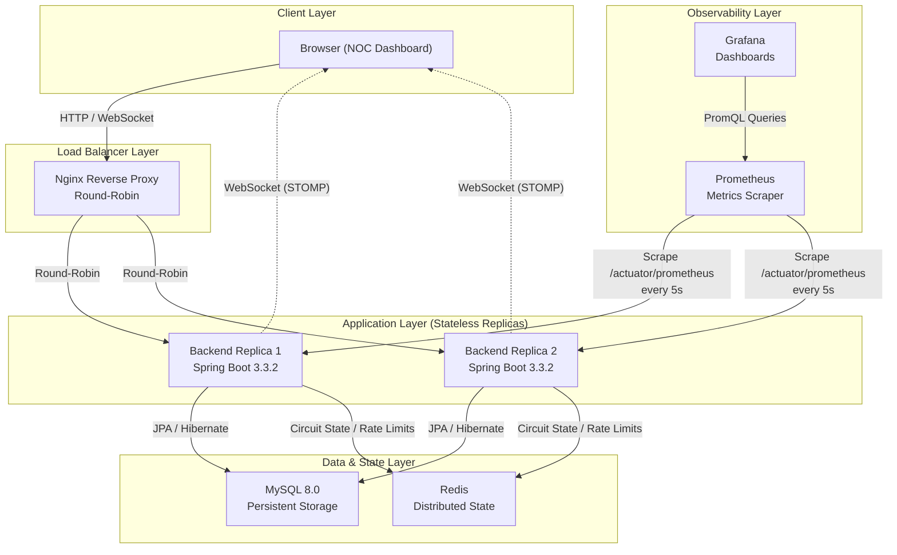
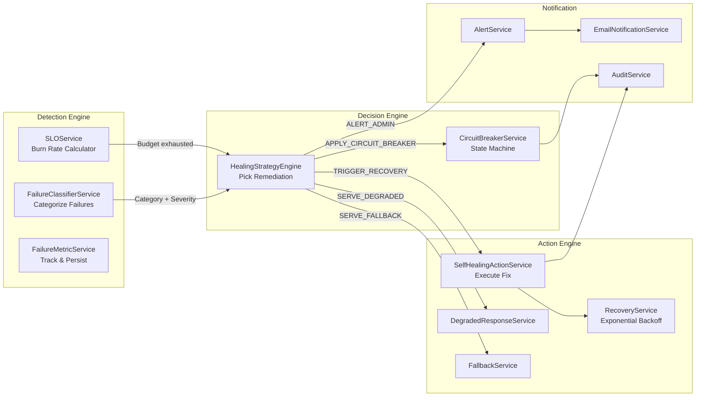
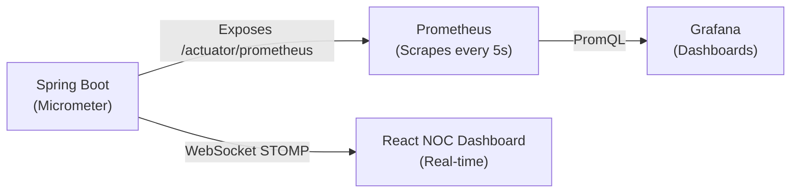
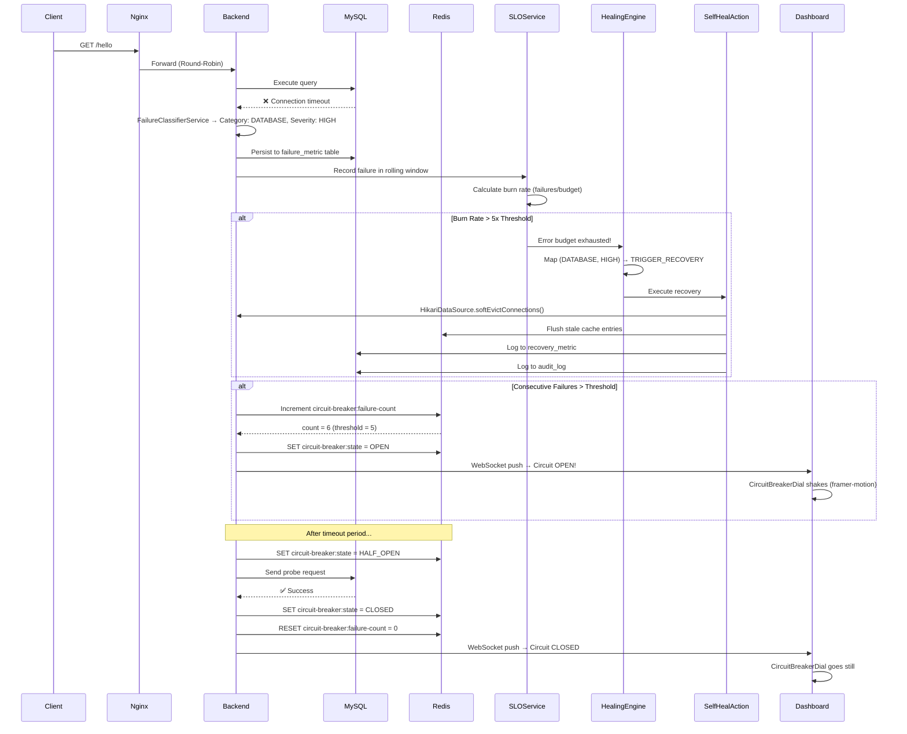
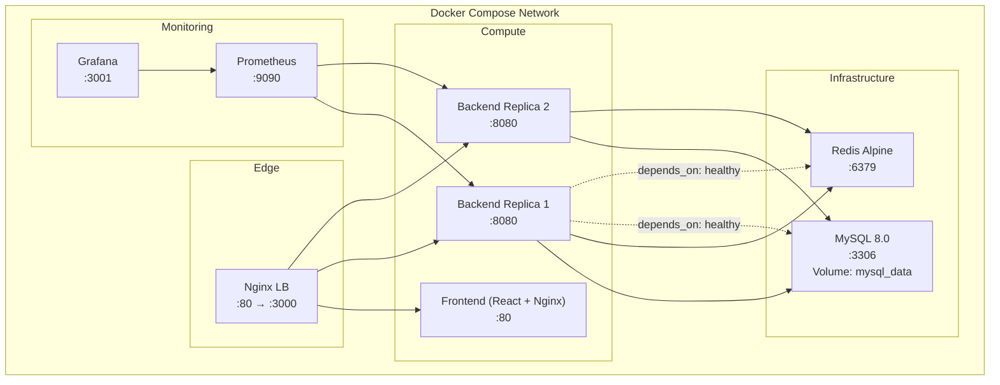

# High-Level Design (HLD) — Self-Healing Backend System (SHBS)

**Version:** 1.0  
**Author:** Ritik Yadav  
**Date:** August 2026

---

## 1. Introduction

### 1.1 Purpose
The Self-Healing Backend System (SHBS) is a distributed, SRE-inspired backend service that autonomously detects failures, makes recovery decisions, and executes remediation actions — all without human intervention. This document describes the high-level architecture, component interactions, data flow, and design decisions.

### 1.2 Scope
This system covers:
- Autonomous failure detection via SLI/SLO monitoring
- Circuit Breaker state machine for cascading failure prevention
- Self-healing remediation pipeline (connection pool reset, cache flush, GC)
- Real-time observability (Prometheus, Grafana, WebSocket NOC Dashboard)
- Stateless JWT security for admin operations
- Horizontally scalable architecture behind a load balancer

---

## 2. System Architecture Overview

---

## 3. Component Breakdown

### 3.1 Load Balancer Layer — Nginx

| Property | Value |
|---|---|
| **Role** | Reverse proxy, traffic distribution, WebSocket upgrade |
| **Algorithm** | Round-Robin across backend replicas |
| **Ports** | `:80` (HTTP), `:3000` (mapped to `:80`) |

**Responsibilities:**
- Routes `/` requests to the React frontend container
- Routes `/health`, `/hello`, `/admin/*`, `/metrics/*`, `/system/*`, `/actuator/*` to the backend upstream
- Upgrades HTTP to WebSocket for `/ws` endpoint
- Forwards `Authorization` headers for JWT-secured `/admin/*` routes

---

### 3.2 Application Layer — Spring Boot Backend

This is the brain of the system. It is **stateless** — any replica can serve any request. All shared state lives in Redis.

#### 3.2.1 Controller Layer (API Surface)

| Controller | Endpoint(s) | Purpose |
|---|---|---|
| `AuthController` | `POST /admin/login` | Issues JWT tokens |
| `AdminController` | `/admin/**` | Circuit breaker controls, config, recovery triggers |
| `HelloController` | `GET /hello` | Primary API endpoint (monitored for SLO) |
| `MetricsController` | `/metrics/**` | Failure metrics, health metrics, recovery metrics |
| `SLOController` | `/admin/slo/**` | SLO status, burn rate, error budget |
| `SystemHealthController` | `/health`, `/system/**` | System health, status dashboard data |

#### 3.2.2 Service Layer (Core Business Logic)

#### 3.2.3 Key Services Explained

| Service | What It Does |
|---|---|
| **SLOService** | Tracks HTTP success/failure in a 5-minute rolling window. Calculates burn rate. Triggers healing if burn rate > 5x threshold. |
| **CircuitBreakerService** | Redis-backed state machine (`CLOSED → OPEN → HALF_OPEN → CLOSED`). Shared across all replicas. Prevents cascading failures. |
| **HealingStrategyEngine** | Decision router. Maps `(FailureCategory, Severity)` → `HealingStrategy` enum: `DO_NOTHING`, `APPLY_CIRCUIT_BREAKER`, `SERVE_DEGRADED`, `SERVE_FALLBACK`, `TRIGGER_RECOVERY`, `ALERT_ADMIN`. |
| **SelfHealingActionService** | Executes the actual fix: `HikariDataSource.softEvictConnections()`, Redis cache flush, `System.gc()`. |
| **RecoveryService** | Orchestrates recovery with **exponential backoff** (2s → 4s → 8s → 16s) to avoid thundering herd on restart. |
| **FailureClassifierService** | Inspects exceptions and categorizes them (e.g., `DATABASE`, `NETWORK`, `TIMEOUT`). |
| **DegradedResponseService** | Serves partial/cached data when the primary source is unavailable. |
| **FallbackService** | Returns hardcoded safe responses when all else fails. |

#### 3.2.4 Security Layer

| Component | Purpose |
|---|---|
| `SecurityConfig` | Spring Security filter chain. Permits public endpoints, secures `/admin/**` with JWT. |
| `JwtAuthFilter` | `OncePerRequestFilter`. Extracts Bearer token from `Authorization` header, validates, sets `SecurityContext`. |
| `JwtUtil` | Generates and validates JWT tokens using HMAC-SHA256. Configurable expiry (default 1 hour). |

**Why JWT over Sessions:** Backend replicas are stateless. If User A authenticates on Replica 1, their next request might hit Replica 2 via Nginx round-robin. JWT tokens are self-contained and can be validated by any replica without a shared session store.

---

### 3.3 Data Layer

#### 3.3.1 MySQL (Persistent Storage)

| Table | Purpose |
|---|---|
| `alert` | Stores triggered alerts with severity and resolution status |
| `audit_log` | Immutable log of every system action (healing triggers, config changes, circuit state transitions) |
| `failure_metric` | Per-failure records: timestamp, category, severity, stack trace |
| `health_metric` | Periodic health snapshots: CPU, memory, response time |
| `recovery_metric` | Tracks each recovery attempt: strategy used, success/failure, duration |
| `system_config` | Key-value runtime configuration (e.g., thresholds, feature flags) |

#### 3.3.2 Redis (Distributed Ephemeral State)

| Key Pattern | Purpose |
|---|---|
| `circuit-breaker:state` | Current state: `CLOSED`, `OPEN`, or `HALF_OPEN` |
| `circuit-breaker:failure-count` | Failure counter for threshold evaluation |
| `circuit-breaker:last-failure-time` | Timestamp for timeout-based HALF_OPEN transition |
| Rate limiter keys | Resilience4j rate limiting counters (5 req / 10s per client) |

**Why Redis over In-Memory:** The system runs 2+ replicas. If Replica 1 detects a database failure and opens the circuit in its own memory, Replica 2 would still be sending requests to the dead database. Redis ensures **global consistency** — when the circuit opens, it opens for everyone.

---

### 3.4 Observability Layer

| Component | Role | Access |
|---|---|---|
| **Micrometer** | In-app metrics library. Exposes JVM, HTTP, HikariCP, and custom metrics. | Embedded in Spring Boot |
| **Prometheus** | Pulls metrics from `/actuator/prometheus` every 5 seconds. Stores time-series data. | `http://localhost:9090` |
| **Grafana** | Queries Prometheus via PromQL. Renders dashboards for p95 latency, error rates, connection pool saturation. | `http://localhost:3001` |
| **React NOC Dashboard** | Real-time operator view. Receives push updates via WebSocket. | `http://localhost:3000` |

---

### 3.5 Frontend — React NOC Dashboard

The dashboard follows a **Network Operations Center** design system: dark void background (`#0A0E14`), monospace for data, red reserved exclusively for active failures.

| Component | Purpose |
|---|---|
| `StatusBar` | Top bar showing global system status (HEALTHY / DEGRADED / DOWN) |
| `CircuitBreakerDial` | Visual state indicator with motion animations (shake on OPEN, pulse on HALF_OPEN, still on CLOSED) |
| `TopologyView` | Visual map of the distributed architecture (Nginx → Replicas → MySQL/Redis) |
| `MetricsPanel` | Live charts for failure rate, response time, throughput |
| `AuditLogPanel` / `AuditLogFeed` | Real-time scrolling feed of system actions |
| `AdminControls` | Manual override buttons (force-open circuit, trigger recovery, flush cache) |
| `AlertsPanel` | Active alert list with severity and timestamps |
| `RecoveryPanel` | History of recovery attempts with success/failure status |
| `SimulatePanel` | Inject failures for demo/testing purposes |
| `StatsCards` | Summary cards: total failures, recoveries, uptime percentage |
| `HealthGauge` | Visual gauge for overall system health score |

---

## 4. Self-Healing Data Flow (End-to-End)

This is the most important section. It shows exactly what happens when a failure occurs, from detection to recovery, with zero human involvement.

---

## 5. Deployment Architecture

| Container | Image | Ports | Health Check |
|---|---|---|---|
| `shbs-db-1` | `mysql:8.0` | `3306:3306` | `mysqladmin ping` |
| `shbs-redis-1` | `redis:alpine` | `6379:6379` | `redis-cli ping` |
| `shbs-backend-1` | `shbs-backend` (custom) | `8080` (internal) | `curl /actuator/health` |
| `shbs-backend-2` | `shbs-backend` (custom) | `8080` (internal) | `curl /actuator/health` |
| `shbs-frontend-1` | `shbs-frontend` (custom) | `80` (internal) | — |
| `shbs-nginx-1` | `nginx:alpine` | `80:80`, `3000:80` | — |
| `shbs-prometheus-1` | `prom/prometheus` | `9090:9090` | — |
| `shbs-grafana-1` | `grafana/grafana` | `3001:3000` | — |

---

## 6. Non-Functional Requirements

| Requirement | How It's Addressed |
|---|---|
| **High Availability** | 2 backend replicas behind Nginx. If one crashes, the other continues serving. |
| **Horizontal Scalability** | Stateless backends. Scale by increasing `replicas: N` in `docker-compose.yml`. |
| **Data Consistency** | Redis is the single source of truth for distributed state (circuit breaker, rate limits). |
| **Security** | JWT stateless auth for admin endpoints. No session cookies. |
| **Observability** | Prometheus + Grafana + WebSocket real-time dashboard. |
| **Resilience** | Circuit Breaker, Exponential Backoff, Rate Limiting, Graceful Degradation, Fallback Responses. |
| **Autonomous Recovery** | SLO burn-rate engine triggers self-healing actions without human approval. |
| **Audit Trail** | Every action (circuit state change, healing trigger, config update) is logged immutably in `audit_log`. |

---

## 7. Future Roadmap (AI/ML Enhancements)

| Enhancement | Description |
|---|---|
| **RAG-Powered RCA** | Vectorize past incident post-mortems. When a failure occurs, retrieve similar incidents and generate context-aware Root Cause Analysis via LLM. |
| **Predictive Anomaly Detection** | Train ML model on historical Prometheus metrics to predict failures before they happen. |
| **Dynamic Threshold Tuning** | AI agent analyzes traffic patterns and adjusts circuit breaker / rate limiter thresholds automatically. |

> All AI features will remain **fully autonomous** — no human-in-the-loop. The system's identity is self-healing.

---

## 8. Technology Justification Summary

| Choice | Why (Not the Alternative) |
|---|---|
| **Redis** over In-Memory Maps | Multi-replica consistency. In-memory maps are per-JVM. |
| **JWT** over Sessions | Stateless replicas. Sessions require sticky sessions or a session store. |
| **Prometheus Pull** over Push | Pull model is simpler, doesn't require agents, and Prometheus controls the scrape rate. |
| **Nginx** over Spring Cloud Gateway | Lightweight, battle-tested, no extra JVM overhead. |
| **Docker Compose** over Kubernetes | Right-sized for single-node deployment (EC2 Free Tier). K8s is overkill for this scale. |
| **Exponential Backoff** over Fixed Retry | Prevents thundering herd problem when a service recovers. |
| **WebSocket** over Polling | Instant push for real-time NOC dashboard. Polling adds unnecessary load and latency. |
