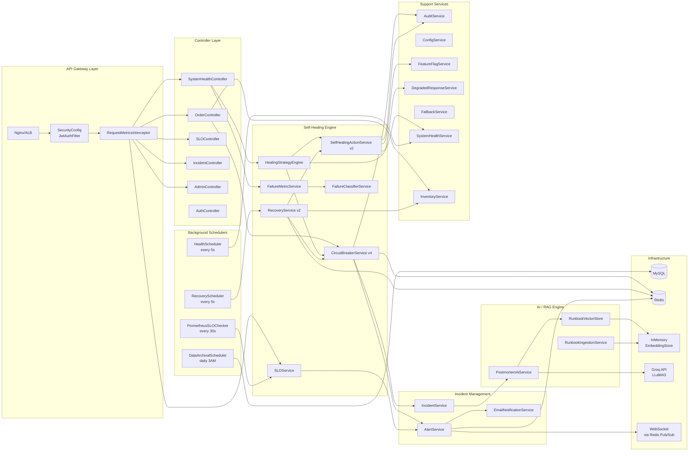
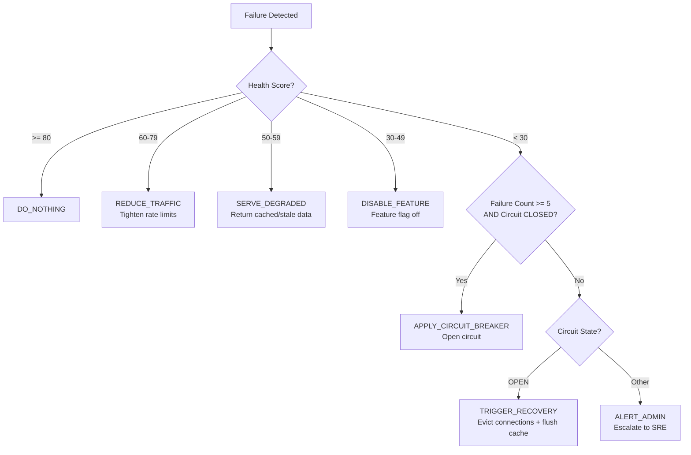

# Self-Healing Backend System (SHBS) — Component Design

## 1. Component Interaction Diagram

This diagram shows the relationships between all major components in the system, organized by their functional domain.

---

## 2. Component Responsibility Matrix

| Component | Responsibility | Dependencies | State Storage |
| :--- | :--- | :--- | :--- |
| **CircuitBreakerService** | Atomic state machine (CLOSED→OPEN→HALF_OPEN→CLOSED) using Lua scripts | Redis, AuditService, AlertService, IncidentService | Redis ZSET + String |
| **SLOService** | Multi-window (5m fast + 1h slow) burn-rate tracking against 99.9% SLO | MeterRegistry | JVM ConcurrentLinkedDeque |
| **HealingStrategyEngine** | Maps (healthScore, circuitState, failureCount) → HealingStrategy enum | SystemHealthService, CircuitBreakerService, SelfHealingActionService | Stateless |
| **SelfHealingActionService** | Executes remediation playbooks with cooldown, idempotency, and distributed locks | DataSource, Redis, AuditService, FeatureFlagService | Redis (cooldown TTLs) |
| **RecoveryService** | Non-blocking, distributed, jittered recovery with canary testing | CircuitBreakerService, InventoryService, Redis | Redis (backoff, locks) |
| **IncidentService** | Full lifecycle: OPEN→ACKNOWLEDGED→MITIGATING→POSTMORTEM_REQUIRED→RESOLVED | AuditService, PostmortemAiService | MySQL |
| **AlertService** | Distributed deduplicated alerting with severity-based routing | Redis, WebSocket, Email | Redis (cooldown key) |
| **PostmortemAiService** | RAG-powered postmortem drafting via Groq LLaMA3 | RunbookVectorStore, ChatLanguageModel | None (async) |
| **RunbookVectorStore** | Semantic search over embedded runbook documents | EmbeddingStore, EmbeddingModel | InMemoryEmbeddingStore |
| **RequestMetricsInterceptor** | Automatically feeds latency + status data to SLOService for every HTTP request | SLOService | Stateless |
| **DataArchivalScheduler** | Archive + batch delete old records; ShedLock ensures single-replica execution | JdbcTemplate, ShedLock (Redis) | MySQL + Filesystem |

---

## 3. Healing Strategy Decision Matrix

The `HealingStrategyEngine` uses the following decision tree:

---

## 4. Remediation Playbook Catalog

| Playbook | Action | Cooldown | Max/Hour | Requires Approval | Rollback |
| :--- | :--- | :--- | :--- | :--- | :--- |
| `EVICT_CONNECTIONS` | `HikariDataSource.softEvictConnections()` | 60s | 10 | No | None |
| `FLUSH_CACHE` | Clears application-level caches | 120s | 5 | No | None |
| `DISABLE_FEATURE` | Sets feature flag to `false` in Redis | 300s | 3 | No | Re-enable flag |
| `REDUCE_TRAFFIC` | Lowers rate limit threshold by 50% | 180s | 5 | No | Restore threshold |
