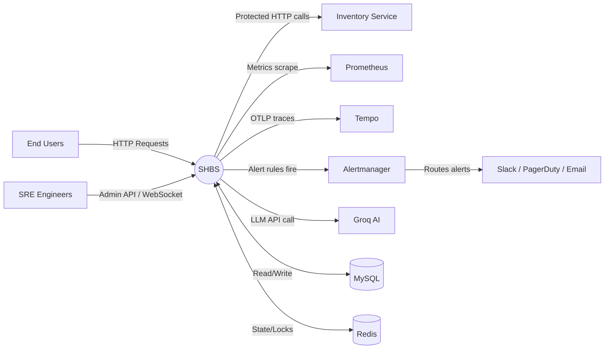
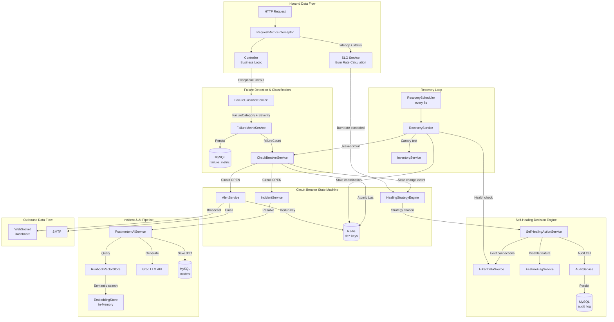
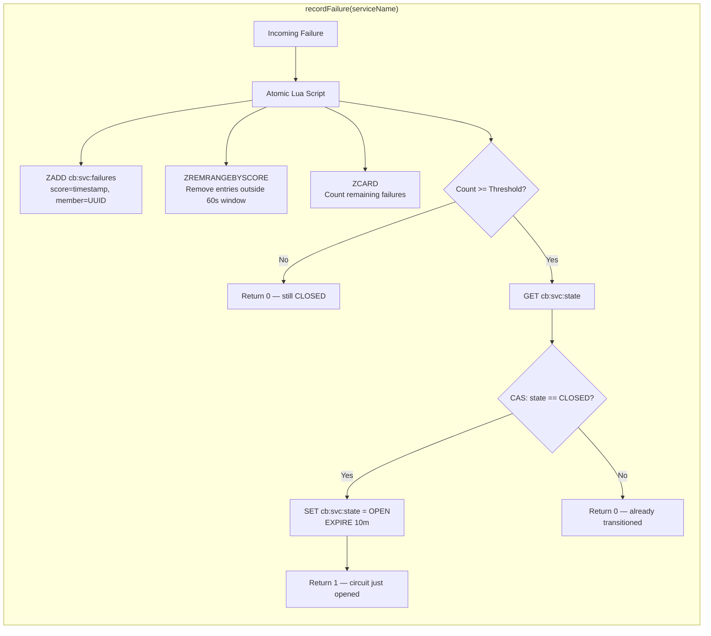
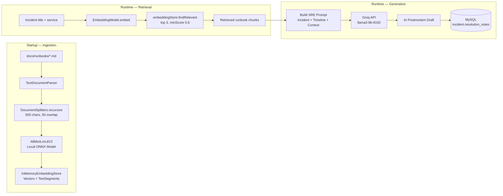
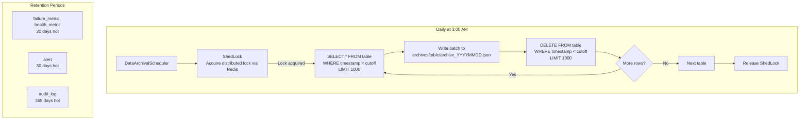
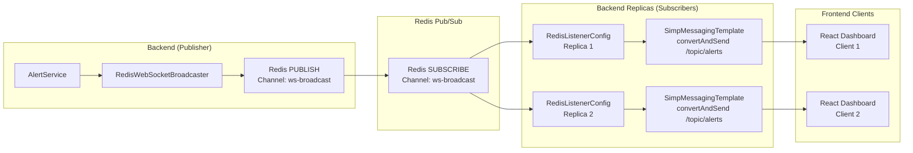

# Self-Healing Backend System (SHBS) — Data Flow Diagrams

## 1. Level 0 — Context Data Flow Diagram



---

## 2. Level 1 — Internal Process Data Flow



---

## 3. Level 2 — Circuit Breaker Internal Data Flow



---

## 4. Level 2 — Recovery Service Internal Data Flow

```mermaid
graph TB
    A[RecoveryScheduler triggers] --> B{Circuit OPEN?}
    B -->|No| SKIP[Skip — nothing to recover]
    B -->|Yes| C{Backoff elapsed?}
    C -->|No| SKIP
    C -->|Yes| D[Acquire distributed lock<br/>SETNX recovery:svc:lock UUID TTL=30s]
    D --> E{Lock acquired?}
    E -->|No| SKIP2[Another replica is handling it]
    E -->|Yes| F[Health Check]
    F --> G{DB valid? Memory > 5%?}
    G -->|No| H[Increment attempts<br/>Increase backoff x2<br/>Execute remediation]
    G -->|Yes| I[Canary Test]
    I --> J{inventoryService.isHealthy()?}
    J -->|No| K[Increment attempts<br/>Increase backoff]
    J -->|Yes| L[CAS: OPEN → HALF_OPEN]
    L --> M[Increment success counter]
    M --> N{Successes >= threshold?}
    N -->|No| O[Wait for next scheduler tick]
    N -->|Yes| P[CAS: HALF_OPEN → CLOSED]
    P --> Q[Reset recovery state<br/>Auto-resolve incidents]
    Q --> R[Release lock via Lua<br/>if token matches]
    H --> R
    K --> R
    O --> R
```

---

## 5. Level 2 — RAG Pipeline Data Flow



---

## 6. Data Retention & Archival Flow



---

## 7. WebSocket Real-Time Broadcast Flow


