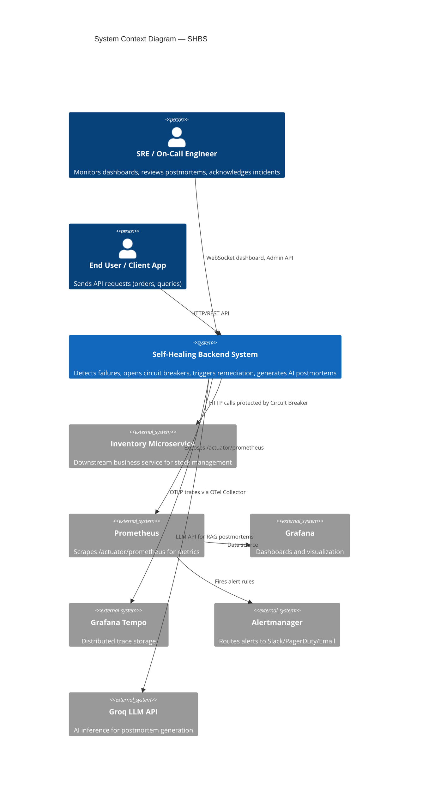
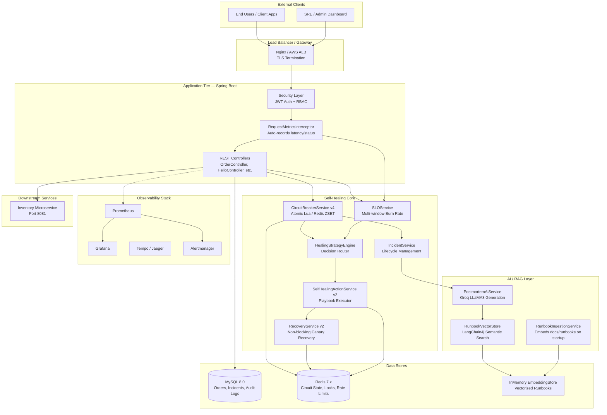
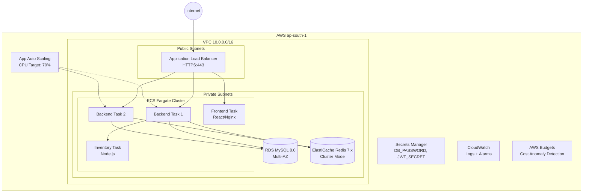

# Self-Healing Backend System (SHBS) — High-Level Design (HLD)

## 1. Executive Summary

The Self-Healing Backend System (SHBS) is an enterprise-grade, SRE-inspired distributed system that **automatically detects, isolates, remediates, and recovers from production failures** without human intervention. It protects downstream business services (e.g., Inventory, Orders) using circuit breakers, SLO-driven burn-rate analysis, and AI-augmented postmortem generation via RAG (Retrieval-Augmented Generation).

---

## 2. System Context Diagram

This diagram shows SHBS as a black box and its relationships with external actors and systems.

---

## 3. High-Level Architecture Diagram

---

## 4. Infrastructure Architecture (AWS ECS Fargate)

---

## 5. Technology Stack

| Layer | Technology | Purpose |
| :--- | :--- | :--- |
| **Backend** | Spring Boot 3.3.2, Java 17 | Core application framework |
| **Frontend** | React 19, MUI 7, Chart.js | NOC Dashboard |
| **Database** | MySQL 8.0 (RDS) | Persistent storage for orders, incidents, audit |
| **Cache/State** | Redis 7.x (ElastiCache) | Circuit breaker state, distributed locks, rate limits |
| **AI/RAG** | LangChain4j 0.33, Groq (LLaMA3-8b) | Postmortem generation via RAG |
| **Embeddings** | all-minilm-l6-v2-q (local ONNX) | Zero-cost local document vectorization |
| **Observability** | Prometheus, Grafana, Tempo, Alertmanager | Metrics, dashboards, traces, alert routing |
| **Tracing** | OpenTelemetry (Micrometer Bridge) | Distributed request tracing |
| **IaC** | Terraform | AWS VPC, ECS, RDS, ElastiCache, Budgets |
| **CI/CD** | GitHub Actions | Build, test, deploy, rollback |
| **Security** | JWT (jjwt 0.12.6), Spring Security | Authentication and RBAC |
| **Scheduling** | ShedLock + Redis | Distributed cron coordination |

---

## 6. Non-Functional Requirements

| Attribute | Target |
| :--- | :--- |
| **Availability** | 99.9% SLO (0.1% error budget) |
| **Latency** | p99 < 500ms for order API |
| **MTTR** | < 30 seconds (automated recovery) |
| **Scalability** | 2–10 ECS tasks via auto-scaling |
| **Audit Retention** | 1 year hot (MySQL) + 7 years cold (S3 archive) |
| **Security** | JWT auth, append-only audit, TLS termination |
