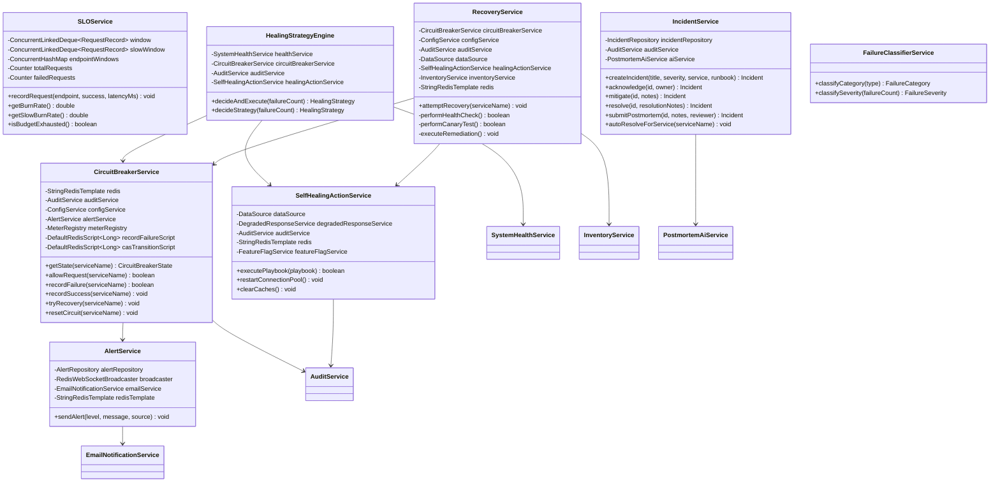
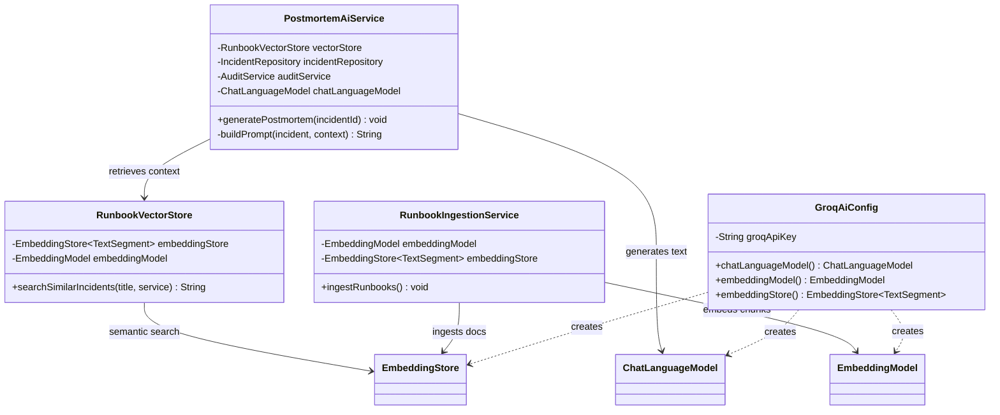
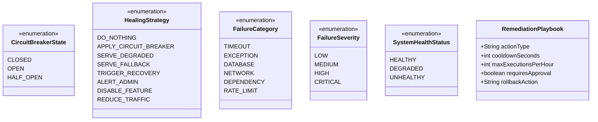

# Self-Healing Backend System (SHBS) — Low-Level Design (LLD)

## 1. Package Structure & Responsibility Map

```
com.selfhealing.backend
├── config/           → Spring configuration beans (Security, WebSocket, Redis, AI, ShedLock)
├── controller/       → REST API endpoints (public + admin)
├── dto/              → Data Transfer Objects for request payloads
├── exception/        → Global exception handler
├── model/            → JPA entities, enums, value objects
├── repository/       → Spring Data JPA repositories
├── scheduler/        → Cron-based background jobs
├── security/         → JWT filter and utility
├── service/          → Core business logic and self-healing engine
└── aspect/           → AOP cross-cutting concerns (request logging)
```

---

## 2. Class Diagram — Core Self-Healing Engine



---

## 3. Class Diagram — AI / RAG Pipeline



---

## 4. Class Diagram — Domain Models (JPA Entities)

```mermaid
classDiagram
    class Order {
        +Long id
        +String product
        +int quantity
        +String status
        +String idempotencyKey
        +LocalDateTime createdAt
    }

    class Incident {
        +Long id
        +String title
        +String state
        +String severity
        +String affectedService
        +String owner
        +String escalationPolicy
        +Integer ackTargetMinutes
        +String suggestedRunbook
        +String timeline
        +String resolutionNotes
        +LocalDateTime createdAt
        +LocalDateTime acknowledgedAt
        +LocalDateTime resolvedAt
    }

    class AuditLog {
        +Long id
        +LocalDateTime timestamp
        +String actionType
        +String details
        +String triggeredBy
        +String result
        +String actor
        +String requestId
        +String ipAddress
        +String targetResource
        +String reason
        +String beforeAfterState
    }

    class FailureMetric {
        +Long id
        +FailureCategory category
        +FailureSeverity severity
        +boolean resolved
        +String endpoint
        +String stackTrace
        +LocalDateTime timestamp
    }

    class Alert {
        +Long id
        +String level
        +String message
        +String source
        +LocalDateTime timestamp
    }

    class RecoveryMetric {
        +Long id
        +String stage
        +String result
        +long durationMs
        +String details
        +LocalDateTime timestamp
    }

    class HealthMetric {
        +Long id
        +int score
        +SystemHealthStatus status
        +LocalDateTime timestamp
    }

    class User {
        +Long id
        +String username
        +String passwordHash
        +String role
    }

    class SystemConfig {
        +String configKey
        +String configValue
        +String description
        +LocalDateTime updatedAt
    }
```



---

## 5. Class Diagram — Enums & Value Objects



---

## 6. Redis Key Schema

| Key Pattern | Type | TTL | Purpose |
| :--- | :--- | :--- | :--- |
| `cb:{service}:state` | String | 10 min | Circuit breaker state (CLOSED/OPEN/HALF_OPEN) |
| `cb:{service}:failures` | ZSET | 10 min | Failure timestamps for windowed counting |
| `cb:{service}:probes` | String (counter) | 10 min | Successful probe count in HALF_OPEN |
| `cb:{service}:probe_active` | String (counter) | 10 min | Concurrent probe limiter |
| `recovery:{service}:lock` | String (UUID) | 30 sec | Distributed recovery lock |
| `recovery:{service}:attempts` | String (int) | — | Retry attempt counter |
| `recovery:{service}:backoff_ms` | String (long) | — | Current exponential backoff value |
| `alert_cooldown:{source}:{level}` | String | 30 sec | Distributed alert deduplication |
| `healing:cooldown:{action}` | String | varies | Action-specific cooldown TTL |
| `healing:lock:{action}` | String (UUID) | 10 sec | Idempotency lock for remediation |
| `rate_limit:{endpoint}` | String (counter) | 60 sec | Per-endpoint rate limit counter |

---

## 7. Database Schema (Flyway Migrations)

```mermaid
erDiagram
    ORDERS {
        BIGINT id PK
        VARCHAR product
        INT quantity
        VARCHAR status
        VARCHAR idempotency_key UK
        DATETIME created_at
    }

    INCIDENT {
        BIGINT id PK
        VARCHAR title
        VARCHAR state
        VARCHAR severity
        VARCHAR affected_service
        VARCHAR owner
        VARCHAR escalation_policy
        INT ack_target_minutes
        VARCHAR suggested_runbook
        TEXT timeline
        TEXT resolution_notes
        DATETIME created_at
        DATETIME acknowledged_at
        DATETIME resolved_at
        DATETIME updated_at
    }

    AUDIT_LOG {
        BIGINT id PK
        DATETIME timestamp
        VARCHAR action_type
        TEXT details
        VARCHAR triggered_by
        VARCHAR result
        VARCHAR actor
        VARCHAR request_id
        VARCHAR ip_address
        VARCHAR target_resource
        TEXT reason
        TEXT before_after_state
    }

    FAILURE_METRIC {
        BIGINT id PK
        VARCHAR category
        VARCHAR severity
        BOOLEAN resolved
        VARCHAR endpoint
        TEXT stack_trace
        DATETIME timestamp
    }

    ALERT {
        BIGINT id PK
        VARCHAR level
        TEXT message
        VARCHAR source
        DATETIME timestamp
    }

    RECOVERY_METRIC {
        BIGINT id PK
        VARCHAR stage
        VARCHAR result
        BIGINT duration_ms
        TEXT details
        DATETIME timestamp
    }

    HEALTH_METRIC {
        BIGINT id PK
        INT score
        VARCHAR status
        DATETIME timestamp
    }

    USERS {
        BIGINT id PK
        VARCHAR username UK
        VARCHAR password_hash
        VARCHAR role
    }

    SYSTEM_CONFIG {
        VARCHAR config_key PK
        VARCHAR config_value
        VARCHAR description
        DATETIME updated_at
    }

    SHEDLOCK {
        VARCHAR name PK
        TIMESTAMP lock_until
        TIMESTAMP locked_at
        VARCHAR locked_by
    }
```



---

## 8. API Endpoint Map

| Method | Path | Auth | Controller | Description |
| :--- | :--- | :--- | :--- | :--- |
| `GET` | `/health` | Public | SystemHealthController | System health score and status |
| `GET` | `/status` | Public | SystemHealthController | Full system status |
| `POST` | `/simulate/failure` | Public | SystemHealthController | Simulates a failure |
| `GET` | `/api/orders` | Public | OrderController | List all orders |
| `POST` | `/api/orders` | Public | OrderController | Create an order (circuit-protected) |
| `GET` | `/api/slo/status` | Public | SLOController | SLO burn rate and budget |
| `GET` | `/api/incidents` | Public | IncidentController | List active incidents |
| `GET` | `/api/incidents/{id}` | Public | IncidentController | Get incident details |
| `POST` | `/api/incidents/{id}/acknowledge` | Admin | IncidentController | Acknowledge an incident |
| `POST` | `/api/incidents/{id}/resolve` | Admin | IncidentController | Resolve an incident |
| `POST` | `/admin/login` | Public | AuthController | Admin JWT login |
| `POST` | `/admin/chaos/*` | Admin (JWT) | AdminController | Chaos injection endpoints |
| `GET` | `/actuator/prometheus` | Admin | Spring Actuator | Prometheus metrics scrape |
