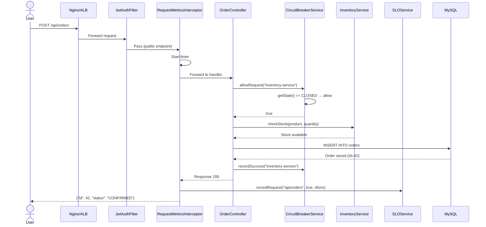
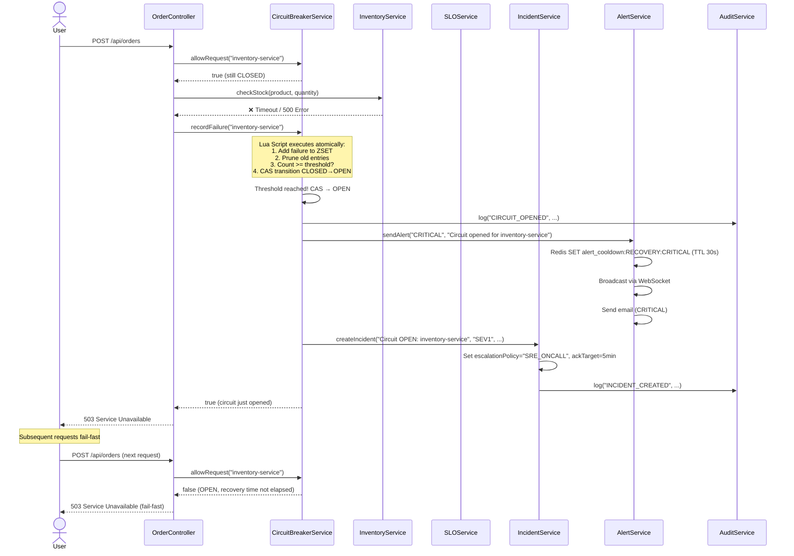
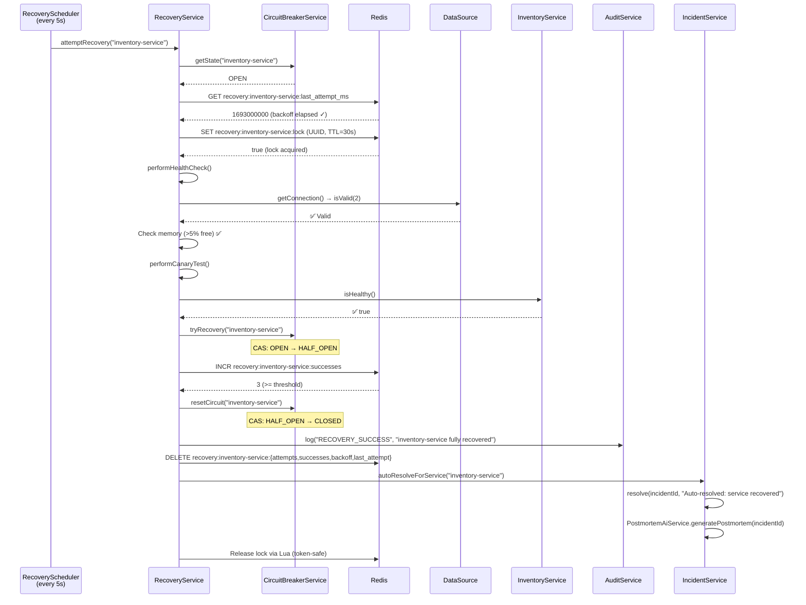
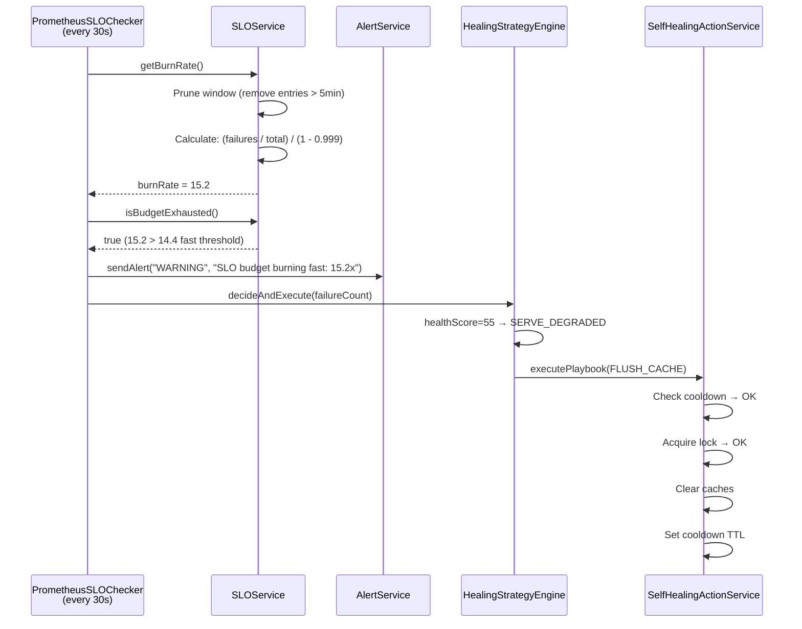
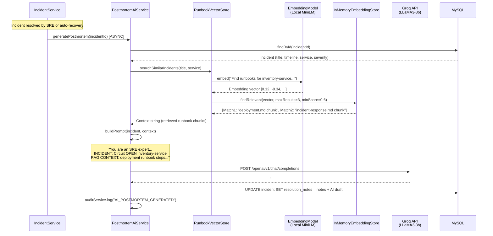
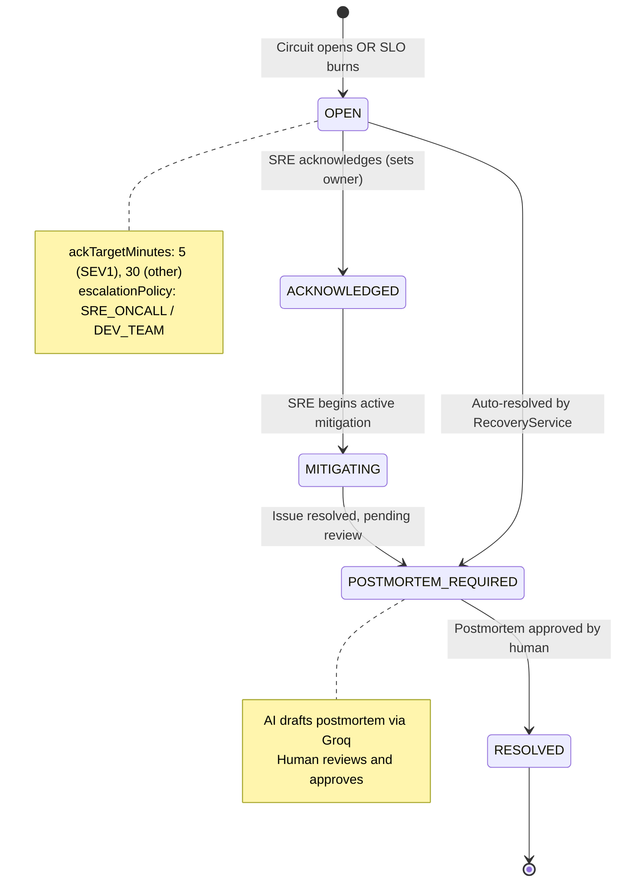
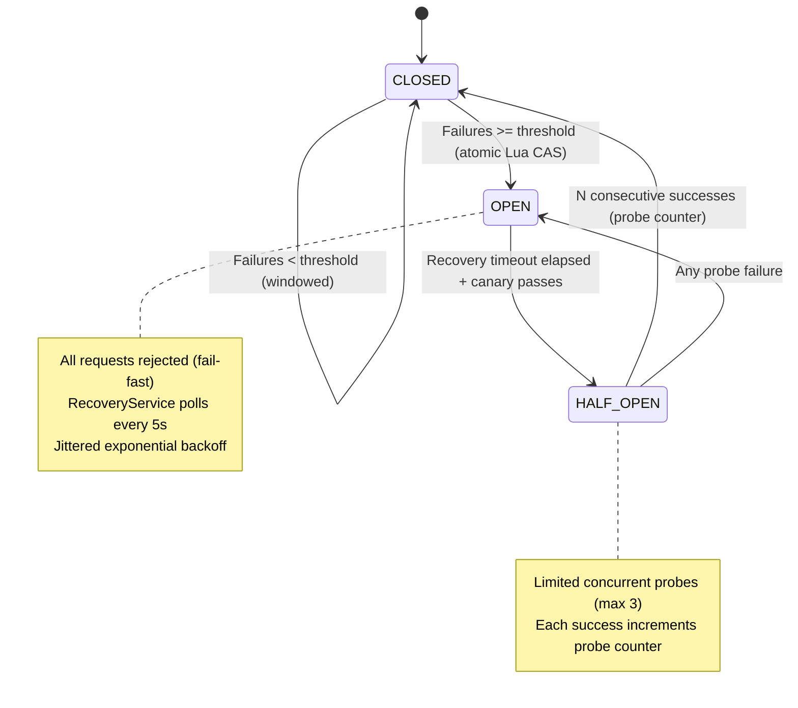

# Self-Healing Backend System (SHBS) — Sequence Diagrams

## 1. Order Request — Happy Path (Circuit CLOSED)

---

## 2. Order Request — Failure Path (Circuit Opens)

---

## 3. Automated Recovery Flow (OPEN → HALF_OPEN → CLOSED)

---

## 4. SLO Burn-Rate Preemptive Healing

---

## 5. AI Postmortem Generation (RAG Pipeline)

---

## 6. Incident Lifecycle State Machine

---

## 7. Circuit Breaker State Machine

