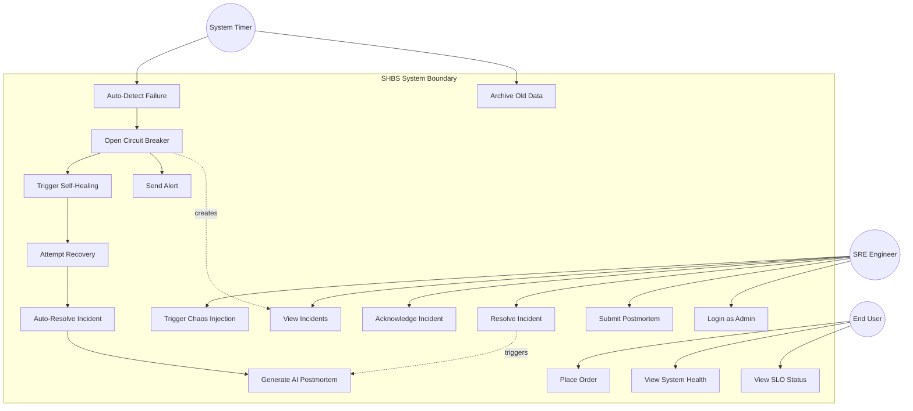
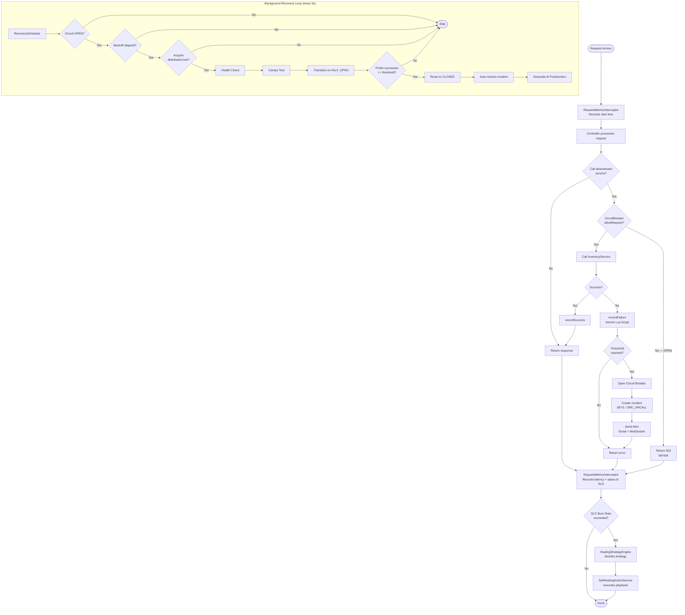
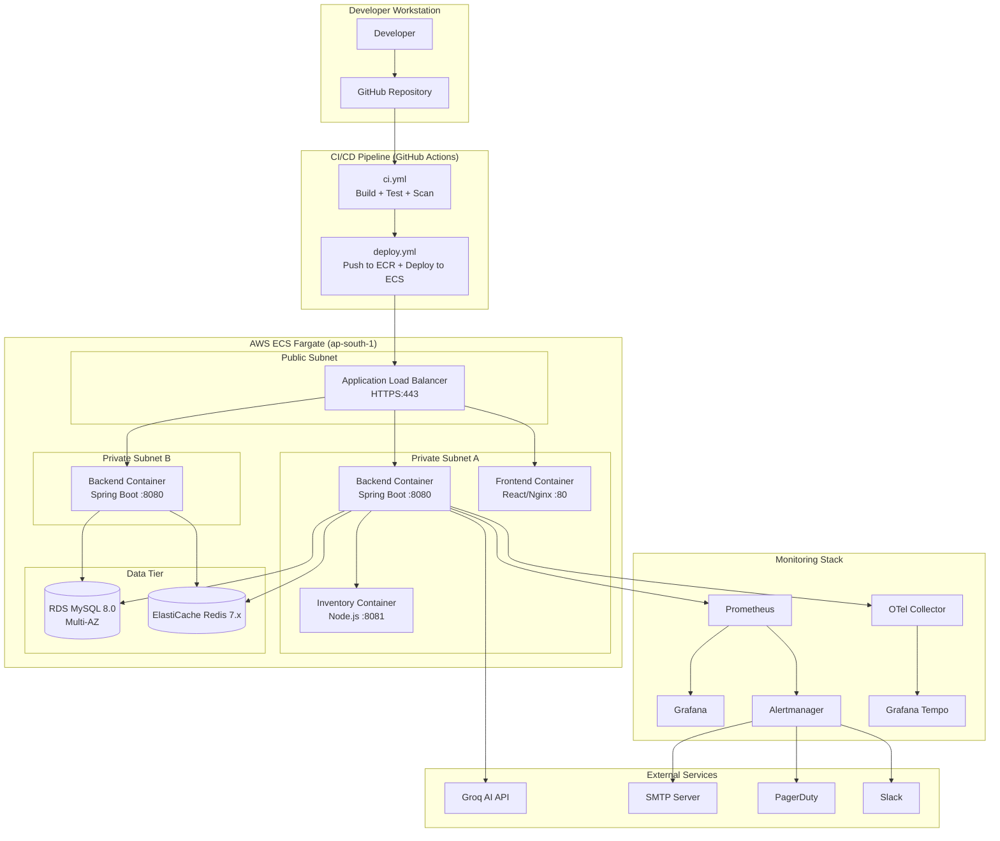
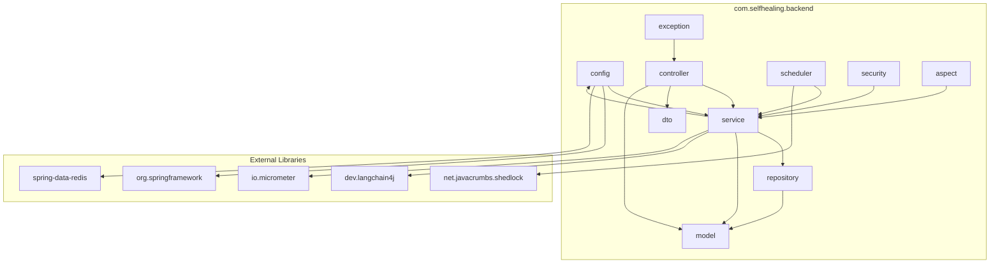
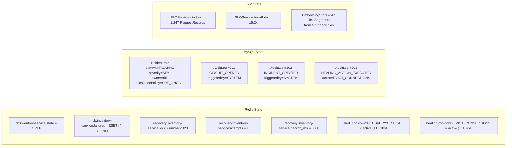
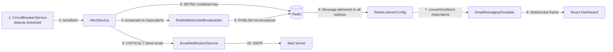

# Self-Healing Backend System (SHBS) — UML Diagrams

## 1. Use Case Diagram

---

## 2. Activity Diagram — Failure Detection to Recovery

---

## 3. Deployment Diagram

---

## 4. Package Diagram

---

## 5. Object Diagram — Runtime Snapshot (During Active Incident)

---

## 6. Communication Diagram — Alert Propagation

